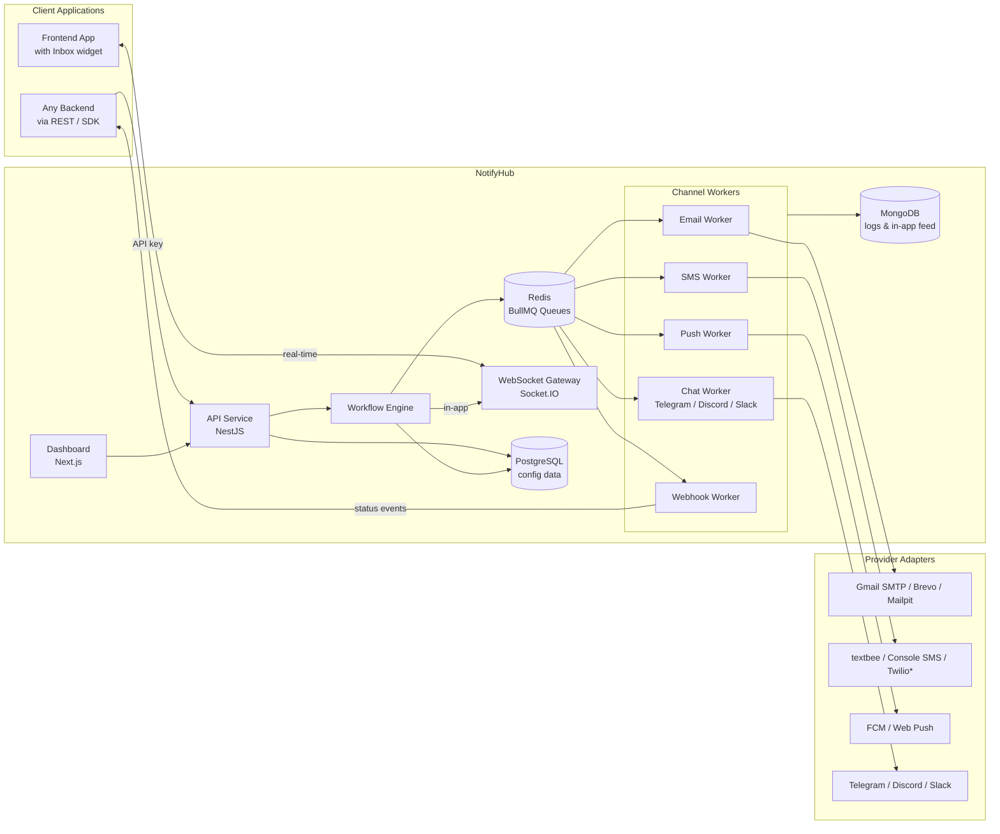
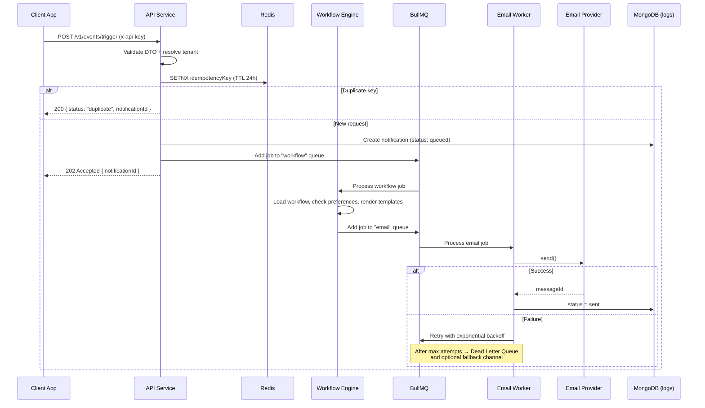
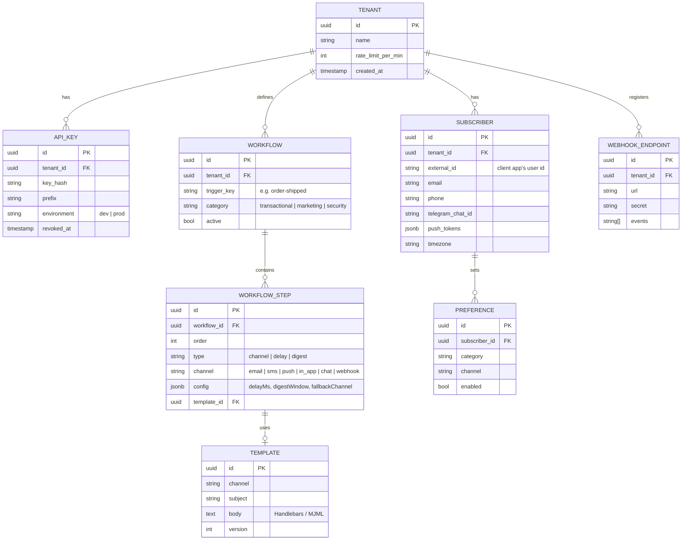
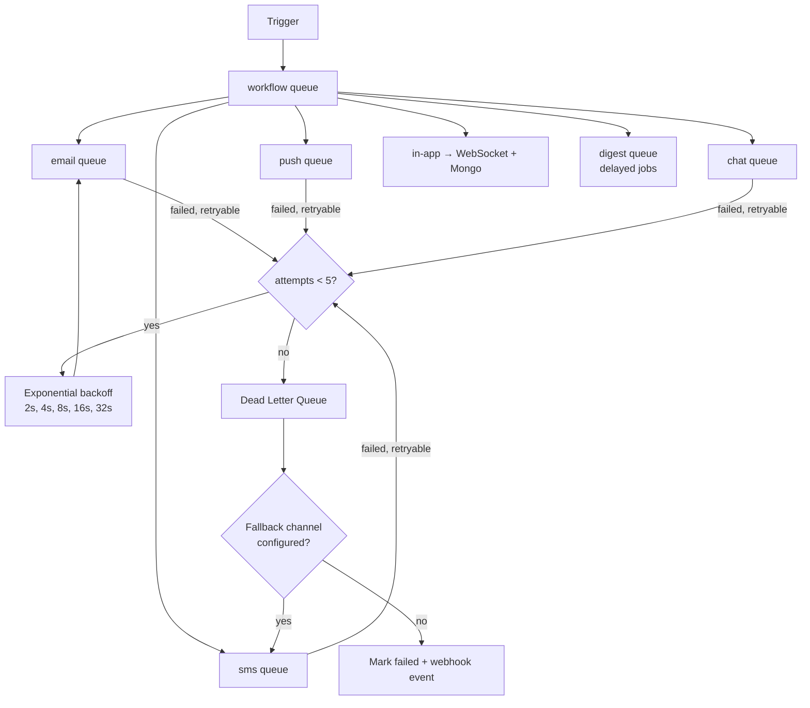

# NotifyHub — Plug-and-Play Notification Platform

> An open-source, self-hosted notification platform. Run it on your own server with one
> command; your apps integrate with one API call or SDK, and NotifyHub handles channels,
> templates, preferences, queuing, retries and delivery logs.
>
> **Budget: $0.** Every tool in this document is free and open source or has a free tier.

---

## 1. What the system does

```ts
// Inside ANY client app (Node, Python, PHP, mobile backend...)
await notify.trigger('order-shipped', {
  to: { subscriberId: 'user_123', email: 'ali@example.com' },
  payload: { orderId: 'A42', eta: 'Tomorrow' },
  idempotencyKey: 'order-A42-shipped',
});
```

NotifyHub then:

1. Authenticates the tenant by API key
2. Loads the `order-shipped` workflow (which channels, in what order, with what delays)
3. Checks the subscriber's preferences (opted out of SMS? quiet hours?)
4. Renders templates per channel (email HTML, SMS text, push title/body, in-app message)
5. Pushes jobs to channel queues
6. Workers send through the providers the operator configured in `.env` (Gmail SMTP, Brevo, FCM, Telegram...)
7. Retries on failure, falls back to another channel if configured, logs every status change
8. Fires outbound webhooks to the client app (`delivered`, `failed`, `read`)

### How it is distributed

- **Open source, self-hosted.** Whoever runs NotifyHub (the *operator*) clones the repo or uses the Docker image and runs it on their own infrastructure. There is no hosted/SaaS version and no billing.
- **One installation = one organization.** The operator puts their own provider credentials (SMTP, Telegram bot token, ...) in `.env`. Nothing is stored per customer, so no credential encryption or per-tenant provider setup is needed.
- **Operator-controlled access.** The first account created is the admin. `SIGNUP_ENABLED` (default `false`) decides whether more accounts can be created; `EMAIL_VERIFICATION_REQUIRED` decides whether they need an emailed OTP.
- **Everything configurable via `.env`,** with sensible defaults in code, validated at startup.
- **SDK on npm** (`@notifyhub/node`) points at the operator's own NotifyHub URL.

---

## 2. High-level architecture



\* Twilio adapter is written and unit-tested with mocks only (see Section 9).

---

## 3. Request lifecycle



---

## 4. Core components

| Component | Responsibility |
|---|---|
| **API Service** | REST API, API-key auth guard, DTO validation, idempotency, rate limiting per tenant, Swagger docs |
| **Workflow Engine** | Resolves workflow steps (channel, delay, digest, fallback), applies subscriber preferences and quiet hours, renders templates |
| **Channel Workers** | One BullMQ queue + worker per channel; isolated so a slow SMS provider never blocks email |
| **Provider Adapters** | Strategy pattern; each provider implements one interface; the operator enables providers and their order in `.env` |
| **WebSocket Gateway** | Pushes in-app notifications in real time; Redis adapter so it scales across instances |
| **Webhook Dispatcher** | Sends signed (HMAC-SHA256) status events back to client apps, with its own retries |
| **Dashboard** | Next.js app served by the operator's own installation: templates with live preview, API keys, workflows, logs explorer, stats |
| **SDK + Inbox widget** | `@notifyhub/node` (typed client) and `@notifyhub/react` (`<Inbox />` bell component) |

---

## 5. Monorepo structure

```
notifyhub/
├── apps/
│   ├── api/                  # NestJS REST API + WebSocket gateway
│   ├── worker/               # NestJS standalone app running BullMQ processors
│   └── dashboard/            # Next.js admin dashboard
├── packages/
│   ├── core/                 # Shared domain types, DTOs, enums
│   ├── providers/            # Provider interfaces + adapters (email, sms, push, chat)
│   ├── templates/            # Handlebars/MJML rendering
│   ├── sdk-node/             # @notifyhub/node
│   └── inbox-react/          # @notifyhub/react <Inbox />
├── examples/
│   └── demo-shop/            # Tiny e-commerce app that uses the SDK (your live demo)
├── docker/
│   └── docker-compose.yml
├── docs/
│   └── architecture.md       # this file
└── load-tests/
    └── trigger.k6.js
```

Use **pnpm workspaces** or **Nx** (both free). Running `api` and `worker` as separate processes is a key design point: you can scale workers independently of the API.

---

## 6. Data model

**PostgreSQL** holds configuration (relational, low volume, needs consistency).
**MongoDB** holds notification logs and the in-app feed (high volume, append-heavy, flexible payloads).



Provider credentials are **not** in the database: the operator sets them in `.env` (see Section 7).

**MongoDB collections**

```js
// notifications — one document per message per channel
{
  _id, tenantId, subscriberId, workflowKey, channel,
  provider, status,            // queued | sent | delivered | failed | read
  attempts, lastError,
  payload, renderedContent,
  idempotencyKey,
  events: [{ status, at, meta }],   // full audit trail
  createdAt
}
// Indexes: { tenantId: 1, createdAt: -1 }, { tenantId: 1, subscriberId: 1, status: 1 },
//          TTL index on createdAt (e.g. 30 days) so logs don't grow forever

// inbox_messages — in-app feed
{ _id, tenantId, subscriberId, title, body, actionUrl, readAt, seenAt, createdAt }
```

---

## 7. Plug-and-play provider design

```ts
// packages/providers/src/interfaces.ts
export interface SendResult {
  success: boolean;
  providerMessageId?: string;
  retryable?: boolean;      // e.g. 429 or 5xx → retry; invalid address → don't
  error?: string;
}

export interface ChannelProvider<TMessage> {
  readonly id: string;          // 'gmail_smtp', 'textbee', 'fcm' ...
  readonly channel: Channel;    // 'email' | 'sms' | 'push' | 'chat'
  send(message: TMessage): Promise<SendResult>;   // credentials are read from .env when the provider is created
}
```

Which providers are used, and in what order, is operator config:

```env
EMAIL_PROVIDERS=brevo,smtp     # try Brevo first, fall back to SMTP if it fails
BREVO_API_KEY=...
SMTP_HOST=smtp.gmail.com
SMTP_USER=...
SMTP_PASS=...
TELEGRAM_BOT_TOKEN=...
```

```ts
// packages/providers/src/registry.ts
@Injectable()
export class ProviderRegistry {
  private providers = new Map<string, ChannelProvider<any>>();

  register(provider: ChannelProvider<any>) {
    this.providers.set(provider.id, provider);
  }

  get(id: string) {
    const p = this.providers.get(id);
    if (!p) throw new Error(`Provider ${id} not registered`);
    return p;
  }
}
```

```ts
// Dynamic module so other developers can plug in their own provider
@Module({})
export class ProvidersModule {
  static forRoot(options: { extraProviders?: Type<ChannelProvider<any>>[] } = {}): DynamicModule {
    const builtIn = [GmailSmtpProvider, BrevoProvider, MailpitProvider, TextbeeSmsProvider,
                     ConsoleSmsProvider, TwilioSmsProvider, FcmPushProvider, WebPushProvider,
                     TelegramProvider, DiscordWebhookProvider, SlackWebhookProvider];
    const all = [...builtIn, ...(options.extraProviders ?? [])];
    return {
      module: ProvidersModule,
      providers: [
        ...all,
        {
          provide: ProviderRegistry,
          useFactory: (...instances: ChannelProvider<any>[]) => {
            const registry = new ProviderRegistry();
            instances.forEach((i) => registry.register(i));
            return registry;
          },
          inject: all,
        },
      ],
      exports: [ProviderRegistry],
    };
  }
}
```

Adding a new provider = one class + one line. The core never changes. That is the story to tell in interviews.

---

## 8. Queue and reliability design



Reliability checklist:

- **Idempotency**: `SETNX idem:{tenantId}:{key}` in Redis with a 24h TTL, plus a unique index in Mongo as a second guard
- **Retry only retryable errors**: providers return `retryable: false` for invalid emails/phone numbers
- **Per-channel queues** with separate concurrency settings
- **Per-tenant rate limiting** with a Redis sliding window (`@nestjs/throttler` with Redis storage, or your own)
- **Graceful shutdown**: workers finish in-flight jobs on `SIGTERM`
- **Digest**: first event creates a delayed job keyed by `{subscriber}:{workflow}`; later events append to a Redis list; when the job fires it sends one combined message
- **Quiet hours**: compute delay from subscriber timezone and enqueue with `delay`
- **Secrets stay in `.env`**: provider credentials are never stored in the database or returned by the API

---

## 9. Channel and provider choices (Pakistan-friendly, $0)

### SMS — about Twilio

Twilio's free trial is **not available for Pakistan sign-ups** (Pakistan is not on the trial's supported-country list). Even where the trial works, it only sends to up to 5 verified numbers, only within the sign-up country, and only using Twilio's pre-defined templates (no custom message bodies). So it is not useful for this project.

**What to do instead:**

| Option | Cost | Use it for |
|---|---|---|
| **ConsoleSmsProvider** (your own fake provider that logs to console / saves to Mongo) | Free | Default for development and CI |
| **textbee.dev** (open-source; turns your Android phone into an SMS gateway via REST API) | Free tier: 300 SMS/month. Messages go out from your own SIM, so your normal mobile SMS bundle applies | Real SMS demo to your own number |
| **TwilioSmsProvider** (write the adapter, unit-test it with mocked HTTP) | Free (no account needed) | Proves the system is pluggable for a "real" provider |

Fun fact: textbee itself is built with NestJS + Next.js + MongoDB, so its source code is worth reading.

### Email — SMTP is perfect

| Option | Cost | Notes |
|---|---|---|
| **Mailpit** (local Docker SMTP catcher with web UI) | Free | Use 90% of the time in development. Nothing is really sent, you see every email in a browser |
| **Gmail SMTP** with an App Password | Free | Enable 2-Step Verification → create App Password. Fine for demos (Gmail has a daily sending cap of roughly a few hundred) |
| **Brevo** | Free forever: 300 emails/day, SMTP + REST API | Good second "real" provider; shows multi-provider support |
| **Resend** | Free: 3,000/month, 100/day | Needs a verified domain to send to others, and a domain costs money, so it is optional |

### Other channels (all free)

| Channel | Provider | Notes |
|---|---|---|
| Push (Android + Web) | **Firebase Cloud Messaging** | Free. iOS push needs a paid Apple Developer account, so skip iOS |
| Browser push | **Web Push** with VAPID keys (`web-push` npm) | Free, no third party at all |
| Chat | **Telegram Bot API** | Free, works in Pakistan, create bot via @BotFather. Excellent "SMS replacement" for demos |
| Chat | **Discord webhooks**, **Slack incoming webhooks** | Free |
| In-app | Your own Socket.IO gateway | Free |
| Webhook | Your own dispatcher | Free; test with a local receiver or webhook.site |

---

## 10. Infrastructure — self-hosted, 100% free

### Running it (development and self-hosting: everything in Docker)

One command starts the databases, queues, API and worker: `npm run dev` (development). Self-hosters will get a production `docker compose` file that also runs the API and worker containers.

```yaml
# docker/docker-compose.yml
services:
  postgres:
    image: postgres:16
    environment:
      POSTGRES_USER: notifyhub
      POSTGRES_PASSWORD: notifyhub
      POSTGRES_DB: notifyhub
    ports: ["5432:5432"]
    volumes: [pg_data:/var/lib/postgresql/data]

  mongo:
    image: mongo:7
    ports: ["27017:27017"]
    volumes: [mongo_data:/data/db]

  redis:
    image: redis:7
    ports: ["6379:6379"]

  mailpit:
    image: axllent/mailpit
    ports:
      - "1025:1025"   # SMTP
      - "8025:8025"   # Web UI → http://localhost:8025

  # Optional observability (Phase 7)
  prometheus:
    image: prom/prometheus
    ports: ["9090:9090"]
  grafana:
    image: grafana/grafana
    ports: ["3001:3000"]

volumes:
  pg_data:
  mongo_data:
```

### Full free stack

| Need | Free choice |
|---|---|
| Backend | NestJS, BullMQ, Socket.IO, Prisma or TypeORM, Mongoose |
| Frontend | Next.js, Tailwind, shadcn/ui |
| Templates | Handlebars, MJML |
| Databases | PostgreSQL, MongoDB, Redis in Docker |
| Distribution | Public GitHub repo, Docker image (GitHub Container Registry), SDK on npm |
| Observability | Prometheus + Grafana (self-hosted), OpenTelemetry, Jaeger |
| Load testing | k6 |
| CI/CD | GitHub Actions (free for public repos) |
| SDK publishing | npm (free for public packages) |
| API docs | `@nestjs/swagger` |

Free-tier limits of third-party providers (Brevo, textbee, ...) change over time, so check each provider's current page before you rely on it.

### Things that cost money (and how to avoid them)

| Paid thing | Free workaround |
|---|---|
| Real SMS via Twilio/Vonage | Console provider + textbee + mocked Twilio adapter |
| iOS push (Apple Developer Program) | FCM for Android + Web Push |
| WhatsApp Business API | Telegram bot instead |

---

## 11. Roadmap

### Phase 1 — Foundation (Weeks 1–2)
- [ ] Monorepo setup (pnpm workspaces / Nx), ESLint, Prettier, Husky
- [ ] Docker Compose with Postgres, Mongo, Redis, Mailpit
- [ ] Tenant + API key module (store only hashed keys, show the key once)
- [ ] `ApiKeyGuard` + tenant context via `AsyncLocalStorage` or request scope
- [ ] Subscriber CRUD API
- [ ] `POST /v1/events/trigger` that sends an email synchronously through Mailpit
- [ ] Swagger docs

### Phase 2 — Async and reliable (Weeks 3–4)
- [ ] Separate `worker` app with BullMQ processors
- [ ] `workflow` queue + `email` queue
- [ ] Retries with exponential backoff, retryable vs non-retryable errors
- [ ] Dead letter queue + Bull Board UI for inspecting queues
- [ ] Idempotency keys
- [ ] Notification status lifecycle + event history in Mongo
- [ ] Integration tests with Testcontainers

### Phase 3 — Channels and provider system (Weeks 5–6)
- [ ] `ChannelProvider` interface + `ProviderRegistry` + dynamic module
- [ ] Email: Mailpit, Gmail SMTP, Brevo
- [ ] SMS: Console, textbee, Twilio (mock-tested)
- [ ] Chat: Telegram, Discord
- [ ] Provider selection and order via `.env` (e.g. `EMAIL_PROVIDERS=brevo,smtp`)
- [ ] Provider priority + failover (Brevo down → Gmail SMTP)
- [ ] Channel fallback in workflows (push failed → Telegram)

### Phase 4 — In-app and real-time (Week 7)
- [ ] Socket.IO gateway with Redis adapter, subscriber auth via signed HMAC hash
- [ ] Inbox API: list, unread count, mark read / mark all read
- [ ] `@notifyhub/react` `<Inbox />` component
- [ ] Web Push (VAPID) + FCM

### Phase 5 — Smart features (Weeks 8–9)
- [ ] Workflow steps: channel, delay, digest
- [ ] Subscriber preferences per category and channel
- [ ] Quiet hours by timezone
- [ ] Per-tenant rate limiting
- [ ] Outbound webhooks with HMAC signatures and retries

### Phase 6 — Dashboard and SDK (Weeks 10–11)
- [ ] Next.js dashboard: login, API keys, workflows, provider status (read-only, configured in `.env`)
- [ ] Template editor with live preview (Handlebars + MJML)
- [ ] Logs explorer with filters (status, channel, subscriber, date)
- [ ] Stats: sent / failed / delivery rate per channel
- [ ] Publish `@notifyhub/node` to npm
- [ ] `examples/demo-shop` using the SDK end to end

### Phase 7 — Production polish (Week 12)
- [ ] OpenTelemetry tracing across API → queue → worker
- [ ] Prometheus metrics (queue depth, latency, success rate) + Grafana dashboard
- [ ] Structured logging with Pino and correlation IDs
- [ ] k6 load test, publish results in README
- [ ] GitHub Actions CI (lint, test, build, publish Docker image)
- [ ] Production `docker compose` file + self-hosting guide (env reference, upgrades, backups)
- [ ] Open-source essentials: LICENSE (e.g. MIT), CONTRIBUTING.md, issue templates
- [ ] README with architecture diagram, design decisions, 2-minute demo video

---

## 12. What makes this stand out

- A README that explains **why**: BullMQ vs Kafka, Postgres + Mongo split, how duplicate sends are prevented if a worker crashes mid-job
- Real numbers from k6 ("X notifications/sec on a single machine")
- A published npm SDK and a working embeddable `<Inbox />` widget
- A demo app that actually uses the platform, plus a portfolio site and short demo video (no live deployment needed)
- Self-hosting in one command: clone, fill in `.env`, run
- Clean provider extension story: "add a provider in one class"

Start with Phases 1–3 and make them solid. A reliable email + Telegram + in-app system with good retries and logs is already a top-tier portfolio project.
